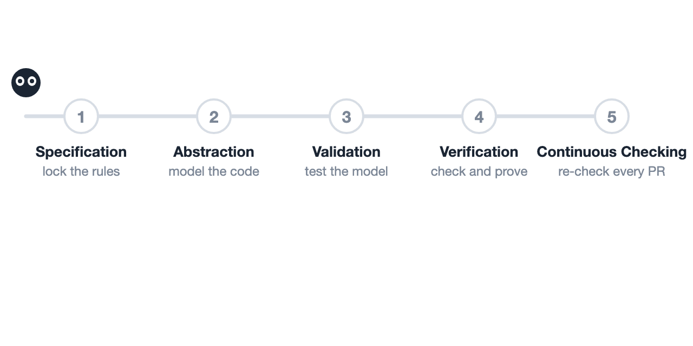

<p align="center">
  <picture>
    <source media="(prefers-color-scheme: dark)" srcset="assets/vstack-logo-dark.svg">
    <source media="(prefers-color-scheme: light)" srcset="assets/vstack-logo-light.svg">
    
  </picture>
</p>

<p align="center">
  <a href="https://haoailab.com/blogs/verifiable-llm-infra/"><b>Blog</b></a> ·
  <a href="https://github.com/hao-ai-lab/veriserve"><b>VeriServe</b></a> ·
  <a href="https://x.com/haoailab/status/2120595980659917024"><b>X</b></a>
</p>

`vstack` is a formal verification toolkit for coding agents. Naive agents routinely game formal checkers by weakening invariants, dropping timeout branches, or adding unverified assumptions; `vstack` enforces mechanical gates across TLA+, Apalache, TLAPS, and Z3 so agents find real bugs and prove critical state machines without cheating.



## Quick Start

```bash
git clone https://github.com/hao-ai-lab/vstack.git && cd vstack
uv tool install -e .
vstack setup   # checks Java/TLC/Z3 and installs skills into Claude Code, Codex, or Cursor
```

Or install directly as a plugin in Claude Code via `/plugin marketplace add hao-ai-lab/vstack` and `/plugin install vstack`, or in Cursor via `/add-plugin vstack`.

Run `/vstack-mode` on a target module and safety property:

```text
/vstack-mode verify that our RDMA KV cache lease manager never recycles an in-flight page on timeout.
```

## Anti-Reward-Hacking Gates

| Gate | What It Enforces |
| :--- | :--- |
| **[Role isolation](docs/layer-0.md)** | Separate coordinator, worker, and red-team agents keep specs, modeling, and review independent. |
| **[Hash-pinned specs](docs/contracts.md)** | SHA-256 locks safety properties and theorem signatures so workers cannot weaken the goal. |
| **[Line-anchored models](docs/method-selection.md)** | Every state variable and action maps to an exact `file:line@commit` across TLC, Apalache, and Z3. |
| **[Mutation & trace gates](docs/gates.md)** | Models must fail on historical bugs, pass with the fix, fail when guards are removed, and [replay real traces](docs/trace-validation.md). |
| **Proof & runtime checks** | Critical state machines scale to unbounded TLAPS proofs with preconditions mirrored as runtime checks. |

## Recommended Models

| Workflow Stage | Recommended Models | Why |
| :--- | :--- | :--- |
| **Modeling, Proofs & Red-Team** | `Fable 5.2`, `GPT-6.1-Sol`, `Gemini 4 Carbon` at high reasoning effort | Strongest at state-machine abstraction, inductive invariants, and catching missing guards. |
| **Code Analysis & Repro Harness** | `Claude Opus 5.5`, `Gemini 4 Carbon` | Fast and reliable at navigating large Python/CUDA codebases and building multi-GPU reproducers. |

## Case Studies

- **Production Bug Hunting:** Confirmed concurrency, lifecycle, and numerical bugs uncovered in [SGLang](https://github.com/sgl-project/sglang) and [vLLM](https://github.com/vllm-project/vllm), with trace-calibrated TLA+ and Z3 counterexamples detailed in our [blog post](https://haoailab.com/blogs/verifiable-llm-infra/).
- **[VeriServe](https://github.com/hao-ai-lab/veriserve):** A Prefill-Decode serving engine built with `vstack`, proved across 226 TLAPS modules with +0.18% average p50 TPOT overhead on NVIDIA GB200.

## Acknowledgments

Skill orchestration draws inspiration from Lauren Tan's [pstack](https://github.com/cursor/plugins/tree/main/pstack). Trace validation and proof gates build on lessons from [Specula](https://github.com/specula-org/Specula), [SysMoBench](https://github.com/specula-org/SysMoBench), and [TLAPS-Bench](https://github.com/specula-org/TLAPS-Bench). We thank the TLA+, Z3, SGLang, and vLLM communities.

## Citation

```bibtex
@misc{vstack2026,
  title        = {Towards Verifiable {LLM} Infra},
  author       = {Zhang, Yuxuan and Zhang, Minshen and Su, Junda and Sun, Yi and Chen, Junda and Zhang, Hao},
  year         = {2026},
  month        = nov,
  howpublished = {Hao AI Lab Blog},
  url          = {https://haoailab.com/blogs/verifiable-llm-infra/}
}
```

## License

MIT License — see [LICENSE](LICENSE) and [NOTICE.md](NOTICE.md).
